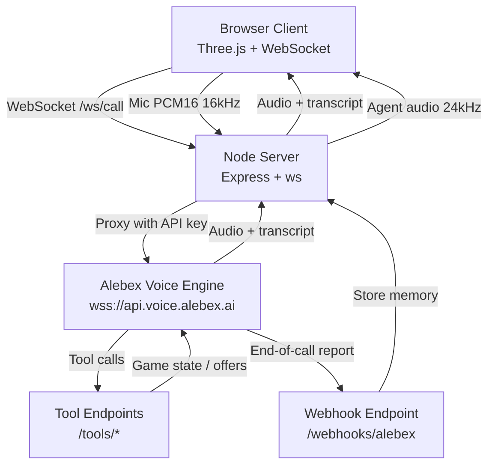

# Open Plan

A 3D office-politics survival game where you navigate manipulation, set boundaries, and learn to protect your energy—all through voice conversations with AI-powered coworkers.

Built for a hackathon using the **Alebex Voice API**.

## 🎮 The Game

You're a new hire on an open-plan office floor. Your goal: survive and get promoted without burning out. Walk freely, talk by voice to coworkers and the boss, accept or decline their offers, and manage your stats.

**Stats:** Energy, Reputation, Performance, and Burnout (0–100)  
**Win condition:** Reach promotion threshold (Performance 70+, Reputation 60+)  
**Lose condition:** Burnout hits 100

Some characters manipulate you, one gets jealous after promotion, some give confidently bad advice, and one is genuinely helpful. The game quietly teaches office-politics lessons: spotting manipulation, setting boundaries, managing up, and protecting your energy.

## 🎨 Look & Feel

Inspired by House House's *Big Walk*: soft pastel low-poly geometry, chunky round characters, minimal faces, flat lighting, gentle fog, wide calm spaces, and playful bobbing movement. All-original procedural art from primitives.

**Setting:** One office floor with cubicle pods, kitchen, meeting room, boss's glass corner office, plants, and windows.

**Controls:**
- WASD/Arrows: Move
- E: Talk to nearby character or collect item
- Third-person camera follows you

## 📦 What's Included

- **3D game client** (Vite + Three.js + TypeScript)
- **Node server** (Express + WebSocket proxy)
- **Voice integration** via Alebex Voice API
- **Demo mode** (fully playable without API key)
- **Agent setup script** (idempotent, creates/updates agents)
- **Tests** (vitest: game engine, webhook signatures, prompt validation)

## 🚀 Quick Start

### Demo Mode (No API Key)

```bash
npm install
npm run dev
```

Open http://localhost:43123 in your browser. The game runs in demo mode with text dialogue and scripted offers.

### Voice Mode

1. **Get an Alebex API key:**
   - Sign up at https://app.alebex.ai
   - Create a voice API key in the developer console

2. **Configure environment:**
   ```bash
   cp .env.example .env
   # Edit .env and add your ALEBEX_API_KEY
   ```

3. **Create agents:**
   ```bash
   npm run setup-agents
   ```
   This creates 6 voice agents (one per character) and saves their IDs to `agents-config.json`.

4. **Optional: Enable tools** (requires public HTTPS URL)
   
   Tools let agents check your game state and make offers during calls. You need a tunnel:

   **Option A: Tailscale Funnel** (recommended)
   ```bash
   # Install Tailscale, then:
   tailscale funnel 3456
   # Copy the HTTPS URL to .env as PUBLIC_BASE_URL
   ```

   **Option B: ngrok**
   ```bash
   ngrok http 3456
   # Copy the HTTPS URL to .env as PUBLIC_BASE_URL
   ```

   Then re-run `npm run setup-agents` to update agents with tool URLs.

5. **Run the game:**
   ```bash
   npm run dev
   ```

   The badge in the top-left shows "Voice Mode" when your API key is detected.

## 🎤 Run Locally with Voice

The simplest path to voice mode on your local machine:

```bash
# Clone the repository
git clone https://origin.cursor.com/git/bananaketchup/tmp-7769dad7229128c6.git
cd tmp-7769dad7229128c6

# Install dependencies
npm install

# Set your API key (get one from https://app.alebex.ai)
export ALEBEX_API_KEY=wt_your_key_here

# Create the voice agents
npm run setup-agents

# Start the server (serves on http://0.0.0.0:3456)
npm start
```

Then open **http://localhost:3456** in your browser (the microphone requires localhost or HTTPS). Walk around, press E near a character to talk by voice, and press E again during a call to hang up.

**Note:** This runs without tools (no PUBLIC_BASE_URL), so offers appear as keyword-detected cards rather than agent-initiated tool calls. The full experience with tools requires a public HTTPS URL (see Voice Mode setup above).

## 🏗️ Architecture



### Key Components

**Client (`src/`):**
- `game.ts` - Three.js scene, player movement, NPC rendering
- `game-engine.ts` - Stats, choices, time, inventory, promotion logic
- `voice-client.ts` - WebSocket to server, mic capture, audio playback (mark-echo rule)
- `characters.ts` - Character definitions and prompts (follows Alebex best practices)
- `items.ts` - Collectible items with stat effects

**Server (`server/`):**
- `index.ts` - Express app, serves client, WebSocket upgrade
- `voice-proxy.ts` - Proxies browser ↔ Alebex WebSocket, hides API key
- `tools.ts` - `/tools/check_player` and `/tools/make_offer` endpoints
- `webhook.ts` - `/webhooks/alebex` with HMAC-SHA256 signature verification

**Scripts (`scripts/`):**
- `setup-agents.ts` - Idempotent agent creation via Alebex API

## 🎭 The Cast

| Character | Role | Archetype | Description | Color |
|-----------|------|-----------|-------------|-------|
| **Marcus Chen** | Senior Product Manager | Flatterer | Lavish praise + endless "urgent" tasks. Means well, doesn't see the pile-on. | Pink |
| **Sarah Kim** | Team Lead | Jealous Peer | Warm until your promotion, then passive-aggressive. | Green |
| **Brad Thompson** | Engineering Manager | Overconfident | Confident terrible advice: skip testing, overcommit, work visible hours. | Blue |
| **Diana Foster** | VP of Operations | Burnout Boss | "We're a family" + unsustainable urgency. Everything is a "temporary emergency." | Purple |
| **James Rivera** | Staff Engineer | Honest Mentor | Actually helpful: boundaries, sustainable pace, respectful no. Easy to overlook. | Yellow |
| **Taylor Brooks** | Office Coordinator | Gossip | Knows everything, shares everything. Not malicious, just can't keep secrets. | Gold |

## 📋 Voice Integration Details

### How It Works

1. **Browser captures mic** (PCM16, 16 kHz, 20 ms frames = 640 bytes)
2. **Server proxies WebSocket** to `wss://api.voice.alebex.ai/public/ws/call`
   - API key sent as `Sec-WebSocket-Protocol: alebex.token.<key>` (never reaches browser)
3. **start_call frame** includes:
   - Agent ID for the character
   - Context: day/time, stats, level, promotion status, items, conversation memory
4. **Audio flows both ways:**
   - Outbound: PCM16 binary frames
   - Inbound: Base64 PCM16 JSON frames at 24 kHz
5. **Mark-echo rule:** Client holds each `mark` frame and echoes it only after audio finishes playing
6. **clear_audio:** Stop all playback immediately, echo held marks
7. **Tools** (when PUBLIC_BASE_URL is set):
   - `check_player` - Returns speakable game state
   - `make_offer` - Presents Accept/Decline choice card
8. **End-of-call webhook** verifies HMAC-SHA256 signature, stores conversation memory

### Prompts

All character prompts follow the Alebex best practices guide:
- No exclamation marks
- Contractions always (I'm, you're, don't)
- Numbers as spoken ("forty-five", not "45")
- Dates as spoken ("Friday, December fifth")
- Money in full words ("twenty-seven dollars and ninety-nine cents")
- Phone numbers digit by digit with pauses
- No markdown, lists, emoji, or symbols
- Short turns (1-2 sentences), then stop
- Honest if asked whether it's an AI

See `src/characters.ts` for full prompts.

## 🧪 Tests

```bash
npm test
```

Covers:
- ✅ Stat clamping (0-100)
- ✅ Burnout game-over trigger
- ✅ Choice acceptance (immediate + delayed effects)
- ✅ Time progression and overtime penalties
- ✅ Promotion thresholds
- ✅ Inventory collection
- ✅ Character memory (last 5 interactions)
- ✅ Webhook signature verification (HMAC-SHA256, constant-time compare, timestamp freshness)
- ✅ Prompt validation (no exclamation marks, placeholders, em/en dashes, reserved names)

## 🔒 Security

- API key never reaches the browser (server-side proxy)
- Webhook signatures verified with HMAC-SHA256, constant-time comparison, 5-minute timestamp window
- Tool endpoints require shared secret (if TOOL_SHARED_SECRET is set)
- Secrets never logged

## 📝 Environment Variables

```bash
# Required for voice mode
ALEBEX_API_KEY=wt_your_api_key_here

# Optional (use defaults if not set)
ALEBEX_API_URL=https://api.alebex.ai/api/v1
ALEBEX_ENGINE_URL=https://api.voice.alebex.ai

# Required for tools (public HTTPS URL)
PUBLIC_BASE_URL=https://your-tunnel.ngrok.io

# Required for webhooks
ALEBEX_WEBHOOK_SECRET=whsec_your_webhook_secret
TOOL_SHARED_SECRET=your_tool_secret_here

# Server port
PORT=3456
```

## 🎯 Design Lessons Embedded

The game teaches:
1. **Spotting manipulation** (flatterer, burnout boss)
2. **Setting boundaries** (declining without guilt)
3. **Managing up** (choosing when to say yes)
4. **Protecting energy** (overtime costs burnout)
5. **Impact over hours** (performance ≠ long hours)
6. **Recognizing good advice** (mentor is easy to overlook)
7. **Reading office dynamics** (jealousy after success, gossip consequences)

## 🛠️ Tech Stack

- **Client:** TypeScript, Vite, Three.js
- **Server:** Node, Express, ws (WebSocket)
- **Voice:** Alebex Voice API
- **Tests:** vitest
- **Build:** TypeScript compiler + Vite

## 📦 Production Build

```bash
npm run build
npm start
```

Builds client to `dist/client`, server to `dist/server`.

## 🐛 Troubleshooting

**"Voice Mode not available"**
- Check `ALEBEX_API_KEY` in `.env`
- Restart dev server after adding key

**"No audio in call"**
- Allow microphone access in browser
- Check browser console for errors
- Ensure you're on a secure origin (localhost or HTTPS)

**"Tools not working"**
- Set `PUBLIC_BASE_URL` to a public HTTPS URL
- Run `npm run setup-agents` again after setting it
- Check server logs for tool endpoint errors

**"Webhook signature fails"**
- Verify `ALEBEX_WEBHOOK_SECRET` matches your webhook config
- Check server clock is accurate (signature includes timestamp)

## 📄 License

MIT

## 🙏 Acknowledgments

- Inspired by the visual style of *Big Walk* by House House
- Built with the Alebex Voice API
- Created for a hackathon
