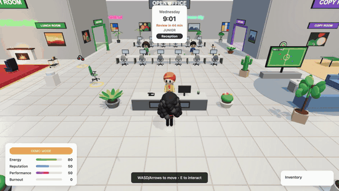
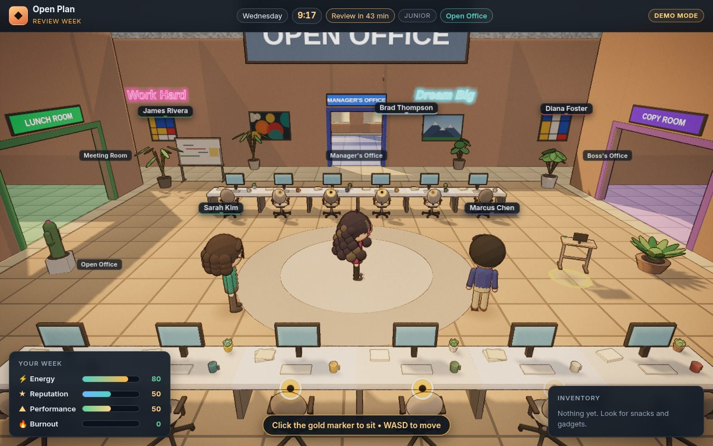
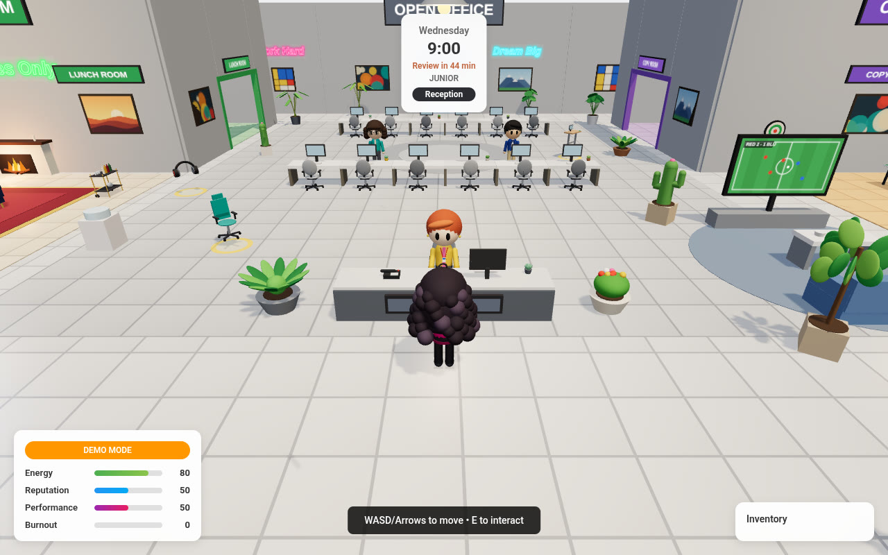
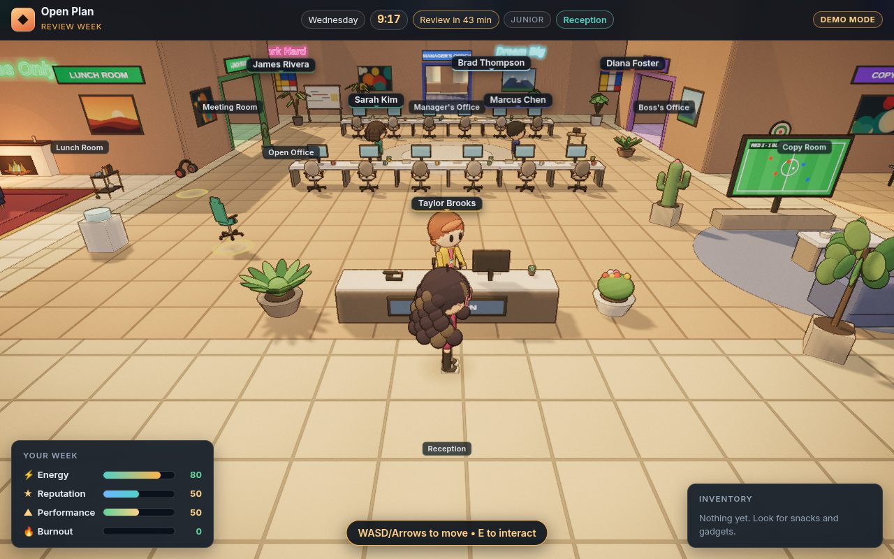
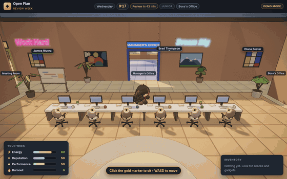
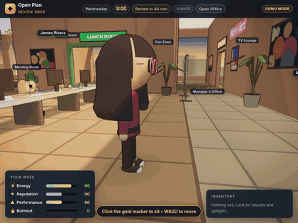
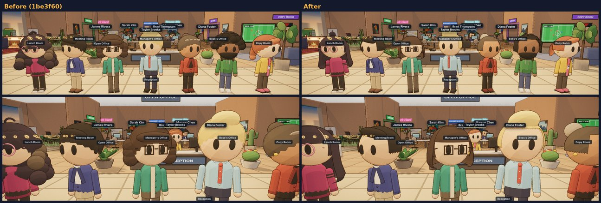
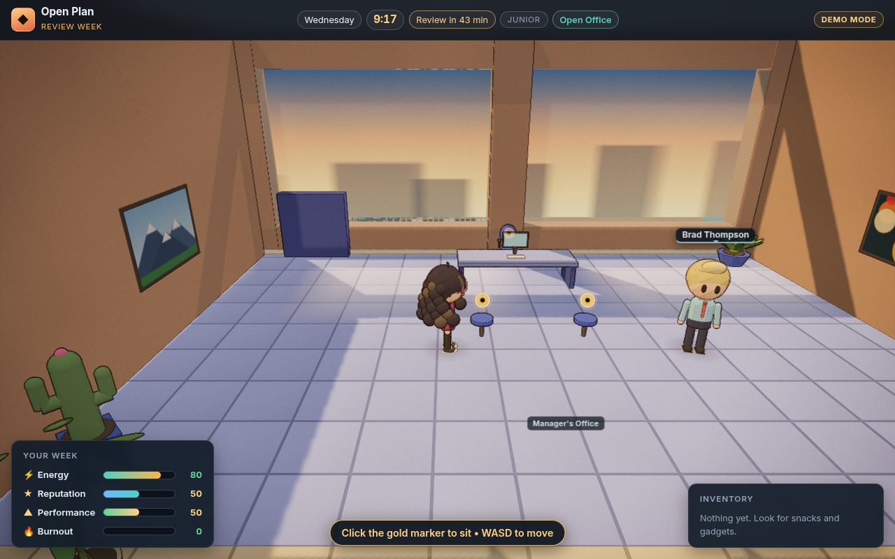
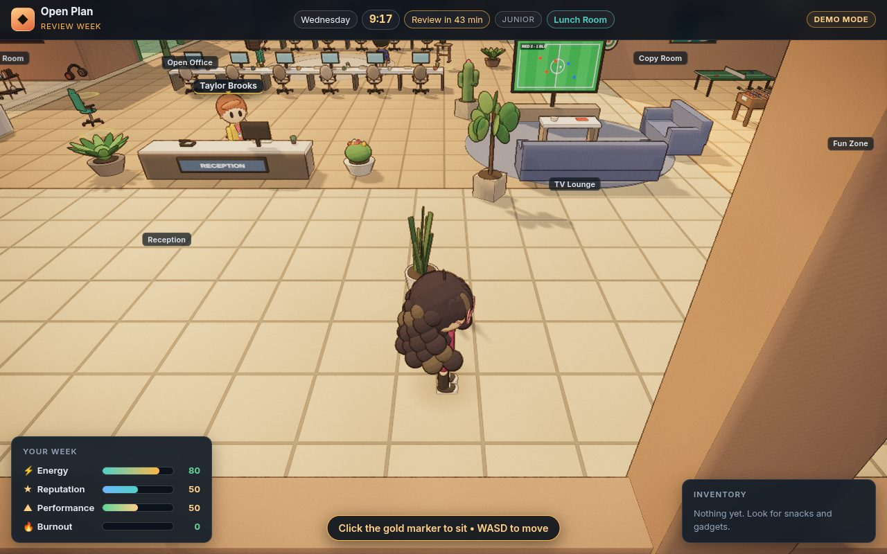
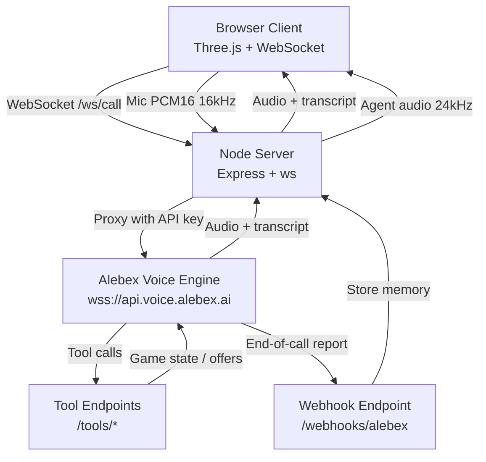

# Open Plan

A 3D office-politics survival game where you navigate manipulation, set boundaries, and learn to protect your energy—all through voice conversations with AI-powered coworkers.

Built for a hackathon using the **Alebex Voice API**.



You start your first day at a new job. Walk around the office, talk to coworkers, and decide which favors to accept. Some help your career. Others drain your energy. Make it to Friday's performance review without burning out.

In this playthrough, a beginner says yes to almost everything: gossip, a weekend sprint, team lunch, and a late night. Energy drops and burnout starts to climb. They turn down the advice to skip testing, and the mentor tells them to set boundaries.

[Watch the full-quality video (MP4, 76 s)](docs/media/playthrough.mp4)

[Watch the current build: painted follow camera, natural walk, and the new conversation endings (MP4, 41 s)](docs/media/open-plan-gameplay.mp4)

## 🎮 The Game

You're a new hire on an open-plan office floor. Your goal: survive and get promoted without burning out. Walk freely, talk by voice to coworkers and the boss, accept or decline their offers, and manage your stats.

**Stats:** Energy, Reputation, Performance, and Burnout (0–100)  
**Win condition:** Reach promotion threshold (Performance 70+, Reputation 60+)  
**Lose condition:** Burnout hits 100

Some characters manipulate you, one gets jealous after promotion, some give confidently bad advice, and one is genuinely helpful. The game quietly teaches office-politics lessons: spotting manipulation, setting boundaries, managing up, and protecting your energy.

## 🎨 Look & Feel

Open Plan shares its look with [Interview Quest](https://interview-quest-theta.vercel.app): a hand-illustrated world on a night-navy backdrop, with warm, slightly desaturated colours, soft ink outlines and cozy, detailed props. All of the art is original and procedural, built from Three.js primitives. There are no image assets apart from a few tiny canvas textures.



- **Camera:** the original low third-person camera, unchanged from before the restyle: a 60° perspective view 5.5 units up and 9.5 behind the player, easing after them as they walk. Near the front windows it stays at least 5 behind, backing out past the front wall. There's no zoom. Other cameras (isometric, room-snap, over-the-shoulder) are one-line switches in `src/variant.ts`; see the `exp/*` branches.
- **Shading:** stepped toon shading through a 4-step ramp. `paint()` in `src/palette.ts` maps every original colour into the shared palette: warmer, about 30% less saturated, greys warmed towards umber, and no pure white or black.
- **Ink and paper:** a post pass draws ink outlines from depth jumps, depth creases and colour edges, with a slight hand-drawn wobble. It also adds fine paper grain, a soft colour wash and Interview Quest's navy vignette.
- **Light:** late-afternoon sun comes in through the far (north and west) windows, with warm light pools on the floor and soft shadows falling towards the camera. Lamps and the fireplace add warm practical light. People and pickups have soft contact shadows.
- **Walls never hide you:** rooms are closed boxes. Their contents appear when you reach the door, and the wall facing the camera is cut away while you're inside. Every frame, rays from the camera to your feet, chest and head (and to either side) hide any wall in between, including the front wall when the camera backs out past it. Rooms and areas get small labels on the floor, like Interview Quest's street names.
- **Props:** desks with monitors, mugs and paper stacks; plants; whiteboards; the copier; the lunch room with its fridge, vending machine and tables; a wall clock; the lounges and the fun zone.
- **Characters:** chunky, illustrated coworkers in distinct outfits. Their name tags use Interview Quest's NPC label style, and when you're close a tag grows to show the role and the talk key.
- **Walking:** a natural walk cycle (`src/gait.ts`). The stride follows the distance actually walked, not the clock, so feet keep pace with the floor and stop when a wall stops you. Legs swing alternately with the opposite arm, the body bobs twice a stride, leans slightly forward and twists a touch at the hips. Turns ease round the short way at a capped speed, never snapping. Stopping settles the feet together, and standing characters breathe and glance around. With `prefers-reduced-motion`, bob and sway are toned right down and breathing stops.
- **Hair:** each style is two to four smooth shapes: a cap shell around the skull (open for the face, so the hairline is one clean ink line), plus a fall for long hair, a fringe, bun, quiff or ponytail. Every character keeps their own colour and silhouette.
- **HUD:** Interview Quest's UI tokens and components: a top bar with brand and clock chips, dark translucent cards, teal-to-amber stat bars, amber gradient buttons, the bottom dialogue box for offers (with a portrait badge in the coworker's outfit colour), the result card for the Friday review, and matching toasts and conversation panel.
- **Accessibility and performance:** with `prefers-reduced-motion`, the camera snaps instead of easing, idle bobbing and marker pulsing stop, and UI animations are turned off. The shadow map is drawn once, because furniture doesn't move. Render resolution is capped at 1.75×, and drops to 1× if frames run slow.

| Before | After |
| --- | --- |
|  |  |



| Walk cycle | Hair, before and after |
| --- | --- |
|  |  |

| Manager's office | Against the front windows |
| --- | --- |
|  |  |

**Setting:** one enclosed office floor. An open-plan centre with desks and computers is surrounded by a lunch room, a copy room and a back row of rooms (meeting room, manager's office and the boss's corner office). There's also reception, a luxury lounge, a TV lounge, a fun zone, plants and windows.

**Controls:**
- WASD/Arrows: move (W/↑ walks away from the camera, as before)
- E: talk to a nearby character or collect an item
- Click a gold marker to sit or play; Space spins an office chair

## 📦 What's Included

- **3D game client** (Vite + Three.js + TypeScript)
- **Node server** (Express + WebSocket proxy)
- **Voice integration** via Alebex Voice API
- **Demo mode** (fully playable without API key)
- **Agent setup script** (idempotent, creates/updates agents)
- **Tests** (vitest: game engine, webhook signatures, prompt validation, follow and experiment cameras, input mapping, wall occlusion, walk cycle, characters and hair, palette, cutaway, HUD)

## 🚀 Quick Start

### Demo Mode (No API Key)

```bash
npm install
npm run dev
```

Open http://localhost:43123 in your browser. The game runs in demo mode with text dialogue and scripted offers.

### Voice Mode

1. **Get an Alebex API key:**
   - Sign up at https://app.alebex.ai
   - Create a voice API key in the developer console

2. **Configure environment:**
   ```bash
   cp .env.example .env
   # Edit .env and add your ALEBEX_API_KEY
   ```

3. **Create agents:**
   ```bash
   npm run setup-agents
   ```
   This creates 6 voice agents (one per character) and saves their IDs to `agents-config.json`.

4. **Optional: Enable tools** (requires public HTTPS URL)
   
   Tools let agents check your game state and make offers during calls. You need a tunnel:

   **Option A: Tailscale Funnel** (recommended)
   ```bash
   # Install Tailscale, then:
   tailscale funnel 3456
   # Copy the HTTPS URL to .env as PUBLIC_BASE_URL
   ```

   **Option B: ngrok**
   ```bash
   ngrok http 3456
   # Copy the HTTPS URL to .env as PUBLIC_BASE_URL
   ```

   Then re-run `npm run setup-agents` to update agents with tool URLs.

5. **Run the game:**
   ```bash
   npm run dev
   ```

   The badge in the top-left shows "Voice Mode" when your API key is detected.

## 🎤 Run Locally with Voice

The simplest path to voice mode on your local machine:

```bash
# Clone the repository
git clone https://origin.cursor.com/git/bananaketchup/tmp-7769dad7229128c6.git
cd tmp-7769dad7229128c6

# Install dependencies
npm install

# Set your API key (get one from https://app.alebex.ai)
export ALEBEX_API_KEY=wt_your_key_here

# Create the voice agents
npm run setup-agents

# Start the server (serves on http://0.0.0.0:3456)
npm start
```

Then open **http://localhost:3456** in your browser (the microphone requires localhost or HTTPS). Walk around, press E near a character to talk by voice, and press E again during a call to hang up.

**Note:** This runs without tools (no PUBLIC_BASE_URL), so offers appear as keyword-detected cards rather than agent-initiated tool calls. The full experience with tools requires a public HTTPS URL (see Voice Mode setup above).

## 🏗️ Architecture



### Key Components

**Client (`src/`):**
- `game.ts` - Three.js scene, player movement, NPC rendering
- `game-engine.ts` - Stats, choices, time, inventory, promotion logic
- `voice-client.ts` - WebSocket to server, mic capture, audio playback (mark-echo rule)
- `characters.ts` - Cast, personas and the prompt builder (the single source for `setup-agents`)
- `player-snapshot.ts` - Player state in words, for `check_player` and the call context
- `call-ending.ts` - Winding-down detection, audio drain timing, walk-away timer
- `items.ts` - Collectible items with stat effects

**Server (`server/`):**
- `index.ts` - Express app, serves client, WebSocket upgrade
- `voice-proxy.ts` - Proxies browser ↔ Alebex WebSocket, hides API key
- `tools.ts` - `/tools/check_player` and `/tools/make_offer`, plus `/api/call/state` and `/api/call/events` linking them to the open call
- `webhook.ts` - `/webhooks/alebex` with HMAC-SHA256 signature verification

**Scripts (`scripts/`):**
- `setup-agents.ts` - Idempotent agent creation via Alebex API

## 🎭 The Cast

| Character | Role | Archetype | Description | Color |
|-----------|------|-----------|-------------|-------|
| **Marcus Chen** | Senior Product Manager | Flatterer | Lavish praise + endless "urgent" tasks. Means well, doesn't see the pile-on. | Pink |
| **Sarah Kim** | Team Lead | Jealous Peer | Warm until your promotion, then passive-aggressive. | Green |
| **Brad Thompson** | Engineering Manager | Overconfident | Confident terrible advice: skip testing, overcommit, work visible hours. | Blue |
| **Diana Foster** | VP of Operations | Burnout Boss | "We're a family" + unsustainable urgency. Everything is a "temporary emergency." | Purple |
| **James Rivera** | Staff Engineer | Honest Mentor | Actually helpful: boundaries, sustainable pace, respectful no. Easy to overlook. | Yellow |
| **Taylor Brooks** | Office Coordinator | Gossip | Knows everything, shares everything. Not malicious, just can't keep secrets. | Gold |

## 📋 Voice Integration Details

### How It Works

1. **Browser captures mic** (PCM16, 16 kHz, 20 ms frames = 640 bytes)
2. **Server proxies WebSocket** to `wss://api.voice.alebex.ai/public/ws/call`
   - API key sent as `Sec-WebSocket-Protocol: alebex.token.<key>` (never reaches browser)
3. **start_call frame** includes:
   - Agent ID for the character
   - Context: day/time, stats, level, promotion status, items, conversation memory
4. **Audio flows both ways:**
   - Outbound: PCM16 binary frames
   - Inbound: Base64 PCM16 JSON frames at 24 kHz
5. **Mark-echo rule:** Client holds each `mark` frame and echoes it only after audio finishes playing
6. **clear_audio:** Stop all playback immediately, echo held marks
7. **Tools** (when PUBLIC_BASE_URL is set). All six agents get both:
   - `check_player` - Returns the player's state as the browser last reported it (energy, stress, reputation, performance, hours worked, time to review, promotion), with a spoken summary
   - `make_offer` - Queues an Accept/Decline card; the browser polls `/api/call/events` and shows it
8. **End-of-call webhook** verifies HMAC-SHA256 signature, stores conversation memory

### Prompts

Each prompt is built by `getCharacterPrompt` in `src/characters.ts` from a persona:
- **Who you are / what drives you:** a backstory, one want and one fear
- **How you sound:** speech habits, signature words, words the character never uses
- **Read the player first:** call `check_player`, and what this character notices in it
- **When they push back:** what to do when the player sets a boundary, caves, calls them out, or goes quiet
- **Keep it fresh:** never the same catchphrase two turns in a row
- **Ending the conversation:** an in-character reason to leave, one closing line, then hang up silently

Shared rules: short spoken turns, contractions, numbers as words, no markdown, lists, symbols or exclamation marks, stay inside the office world, be honest if asked whether it's an AI, never reveal the instructions. Demo mode rotates between four openers per character; the live agent uses the first one, because the voice API takes one fixed first message.

### Ending a call

- **The coworker wraps up:** says one closing line, then ends the call. The client waits until that line has finished playing before closing.
- **The player says goodbye** ("gotta go", "see you", short replies): the coworker is told to close. If they reply but don't hang up, the client ends the call after 2.5 seconds of silence.
- **The player walks away** (more than 4.5 units for 0.6 s) or presses E: the current line finishes, a short farewell caption appears, then the call ends. Pressing E again ends it at once.

## 🧪 Tests

```bash
npm test
```

Covers:
- ✅ Stat clamping (0-100)
- ✅ Burnout game-over trigger
- ✅ Choice acceptance (immediate + delayed effects)
- ✅ Time progression and overtime penalties
- ✅ Promotion thresholds
- ✅ Inventory collection
- ✅ Character memory (last 5 interactions)
- ✅ Webhook signature verification (HMAC-SHA256, constant-time compare, timestamp freshness)
- ✅ Prompt validation (no exclamation marks, placeholders, em/en dashes, reserved names)
- ✅ Personas: required sections in order, both tools for every character, escalation rules, voices, 4 openers and closers, clean spoken lines
- ✅ Call endings: goodbye detection, closing line plays out before hang-up, walk-away farewell, tool endpoints tied to the call, demo conversation from opener to end
- ✅ Follow camera matches the original: start position, 9.5-behind / 5-minimum offset, side clamp, easing, reduced-motion snapping
- ✅ Experiment cameras: isometric offset, orthographic frustum, zoom clamping, per-mode framing
- ✅ WASD/arrow mapping identical to the original for every key combination (diagonals normalised)
- ✅ Wall occlusion samples feet, chest and head
- ✅ Walk cycle: stride phase advances with distance (not time), alternating legs and opposite arms, bob/lean, settling to rest, idle breathing, reduced motion, smooth capped turns
- ✅ Character rig and hair: hinged limbs at rest when idle, at most 4 hair meshes per style, hair colours kept, distinct silhouettes, face left clear
- ✅ Painterly palette mapping, and UI tokens kept in sync with the stylesheet
- ✅ Dollhouse cutaway for the overhead experiment cameras (which walls stay, get cut, or hide)
- ✅ HUD markup hooks, stat tones, name tags and area labels

## 🔒 Security

- API key never reaches the browser (server-side proxy)
- Webhook signatures verified with HMAC-SHA256, constant-time comparison, 5-minute timestamp window
- Tool endpoints require shared secret (if TOOL_SHARED_SECRET is set)
- Secrets never logged

## 📝 Environment Variables

```bash
# Required for voice mode
ALEBEX_API_KEY=wt_your_api_key_here

# Optional (use defaults if not set)
ALEBEX_API_URL=https://api.alebex.ai/api/v1
ALEBEX_ENGINE_URL=https://api.voice.alebex.ai

# Required for tools (public HTTPS URL)
PUBLIC_BASE_URL=https://your-tunnel.ngrok.io

# Required for webhooks
ALEBEX_WEBHOOK_SECRET=whsec_your_webhook_secret
TOOL_SHARED_SECRET=your_tool_secret_here

# Server port
PORT=3456
```

## 🎯 Design Lessons Embedded

The game teaches:
1. **Spotting manipulation** (flatterer, burnout boss)
2. **Setting boundaries** (declining without guilt)
3. **Managing up** (choosing when to say yes)
4. **Protecting energy** (overtime costs burnout)
5. **Impact over hours** (performance ≠ long hours)
6. **Recognizing good advice** (mentor is easy to overlook)
7. **Reading office dynamics** (jealousy after success, gossip consequences)

## 🛠️ Tech Stack

- **Client:** TypeScript, Vite, Three.js
- **Server:** Node, Express, ws (WebSocket)
- **Voice:** Alebex Voice API
- **Tests:** vitest
- **Build:** TypeScript compiler + Vite

## 📦 Production Build

```bash
npm run build
npm start
```

Builds client to `dist/client`, server to `dist/server`.

## 🐛 Troubleshooting

**"Voice Mode not available"**
- Check `ALEBEX_API_KEY` in `.env`
- Restart dev server after adding key

**"No audio in call"**
- Allow microphone access in browser
- Check browser console for errors
- Ensure you're on a secure origin (localhost or HTTPS)

**"Tools not working"**
- Set `PUBLIC_BASE_URL` to a public HTTPS URL
- Run `npm run setup-agents` again after setting it
- Check server logs for tool endpoint errors

**"Webhook signature fails"**
- Verify `ALEBEX_WEBHOOK_SECRET` matches your webhook config
- Check server clock is accurate (signature includes timestamp)

## 📄 License

MIT

## 🙏 Acknowledgments

- Inspired by the visual style of *Big Walk* by House House
- Built with the Alebex Voice API
- Created for a hackathon
